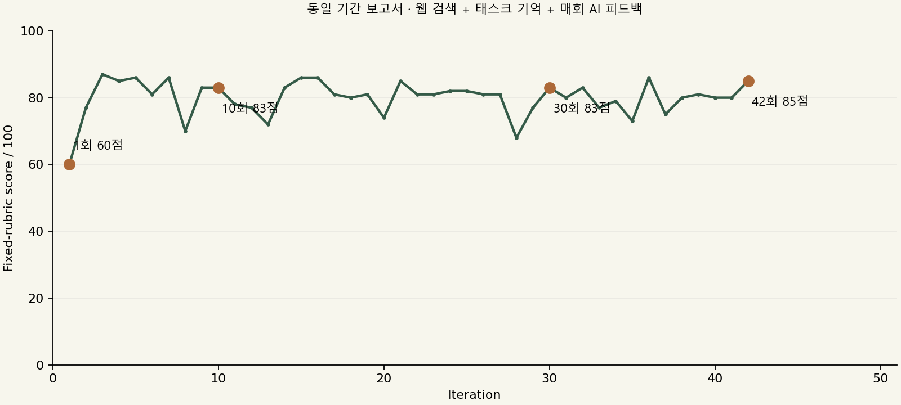

# 42회 실행 후 중간평가

**판정: 초반 오류 수정과 보고서 구체화는 확인했다. 지속적인 지식 축적과 전문가 수준으로의 누적 발전은 아직 입증되지 않았다.**

사용자 요청으로 42회 보고서 작성·AI 평가·피드백 완료 후 중단했다. 작성 중이던 43회 Run은 중단 사유를 남겨 실패로 보존했고 재실행하지 않았다. 50회차 결과, 사후 블라인드 반복평가, 무기억 대조군은 실행하지 않았다. 43회 중단은 모델 품질 실패와 구분한다.

등록 Task는 `USER-b884a865-8872-40f6-ba63-4883c541522c`이며, 주제는 **2025년 9월 우리 집 체감물가와 생활비 대응 보고서**다. 보고기간과 가상 A/B 가구는 고정했고 매회 실제 gpt-6-luna 모델과 웹 도구를 사용했다. 이는 현행 물가나 실제 개인 가계 보고서가 아니다.

| 회차 | 수행 중 AI 점수 /100 | 원문 검토에서 확인한 변화 |
|---:|---:|---|
| [1](round-01/report.md) | 60 | A 증가액을 49,200원으로 오산. 독립 Decimal 계산은 50,800원. 행동 제안이 일반적. |
| [10](round-10/report.md) | 83 | A/B 가중상승률과 전체 CPI 일괄 적용 대비 차이를 정확히 비교. 8월 공식 자료를 추가해 통신료 효과 설명. |
| [30](round-30/report.md) | 83 | 계산과 원인·가정 구분을 유지. 10회차보다 뚜렷하게 높은 수행 수준은 확인하기 어려움. |
| [42](round-42/report.md) | 85 | 소득 대비 영향(1.69%/1.55%)과 선택적 4주 지출상한 X×0.95를 추가. 소폭 구체화했지만 기존 구성의 연장. |
| 50 | 미실행 | 추정 점수나 결과를 만들지 않음. |

## 전체 흐름

| 구간 | 평균 AI 점수 |
|---|---:|
| 1~10 | 79.8 |
| 11~20 | 79.8 |
| 21~30 | 80.1 |
| 31~40 | 79.4 |
| 41~42(2회뿐) | 82.5 |

42회 전체 평균은 약 79.9점이다. 첫 보고서와 마지막 보고서의 차이는 있지만, 10개 단위 평균에서 지속 상승은 관측하지 못했다. 42회차 85점만으로 안정적으로 고도화됐다고 결론 내릴 수 없다.

## 사용자 의도와의 일치 여부

- **동일 태스크의 지속 수행·실제 검색·이력 보존:** 작동했다. 42개 보고서와 검색, 피드백, Run/Artifact/기억 해시가 남았다.
- **피드백의 다음 실행 반영:** 작동했다. 초기 계산이 수정되고 지표 구분·가상 가계 비교·행동 조건이 보강됐다.
- **장기 지식의 누적·재사용:** 부족하다. 다음 실행은 최근 초안2개와 검토 의견3개 중심이다. 확인한 원문 교정 의견도 최근 창에서 빠졌다. 전체 이력이 저장된 것과 검증된 지식이 계속 실행에 활용되는 것은 별개다.
- **회차가 쌓일수록 고차원적인 수행으로 발전:** 현재 실험에서 확인하지 못했다. 최근의 일부 보완을 반영하면서 앞서 반영한 비교 항목이 다시 빠지는 일이 반복됐다. 검색도 여러 회차에서 같은 자료를 다시 찾는 수준이었다.
- **안정적인 품질평가:** 부족하다. 같은 모델의 별도 요청이 자동 채점했고, 평가 의견에도 잘못된 인과 요구와 독해 오판이 있었다. 이를 확정 사실이나 사람 승인으로 처리하지 않았다.

## 점수를 그대로 신뢰하면 안 되는 이유

19·30회차 평가자는 확인되지 않은 ‘전년도 감면/낮은 기저’ 설명을 추가하라고 요구했다. 원문이 설명하는 것은 2025년8월 한시적 감면과 9월 종료다. 20회차 평가자는 두 수치에 함께 적용되는 ‘하락’을 오독해 부호 오류 경고를 냈다. 원래 점수·의견은 보존하고 별도 원문 교정 기록을 남겼다. [검토 기록](spot_audit.json), [개입·설정 변경 기록](PROTOCOL_NOTES.md).

42회차 AI 평가자는 추가 8월 수치를 자기에게 제공한 9월 입력만으로 확인할 수 없다고 지적했다. 앞서 직접 연 공식 8월 원문은 해당 수치를 뒷받침한다. 평가자에게 실제 검색 근거가 충분히 전달되지 않는 문제도 드러났다. URL이 있거나 AI 점수가 높다는 사실은 독립적 사실 검증을 의미하지 않는다.

## 다음 수정의 우선순위

1. **검증된 태스크 지식 저장:** 사실·원문 버전·계산법·유효조건·반증과 폐기 이력을 저장하고, 최근3개 의견 창과 별도로 필요한 지식을 검색한다. AI 의견은 검증 전 가설로 유지한다.
2. **피드백을 수행 절차·회귀 사례로 전환:** ‘누락된 항목을 넣어라’라는 메모를 실행 체크리스트와 고정 검증으로 바꿔, 다음 회차에서 다시 빠지는 것을 잡는다. 방법 변경은 기존 평가와 명시적 적용을 사용한다.
3. **작성과 검증의 역할 강화:** 산술은 Python으로 처리하고, 추가 검색 근거를 평가자에게 전달한다. 전문가가 라벨링한 사례와 별도 평가자·무기억 대조·다른 가구 사례로 점수의 신뢰도와 일반화를 확인한다.

## 실험의 한계와 근거

한 주제·한 경로의 반복 수정 실험이다. 작성과 채점에 같은 모델을 사용했으며 인간 전문가 수준으로 보정하지 않았다. 웹 자료 추가와 피드백 효과를 분리하지 않았다. 사용자 중단으로 블라인드 재채점과 무기억 대조도 미실행이다. 12·13회 평가 JSON 잘림에 대한 기술적 보완과 19·20·30회 원문 교정 개입은 프로토콜 문서에 공개했다. 원래 생성물이나 점수를 유리한 것으로 교체하지 않았다.

- [원본 집계와 해시](summary.json)
- [고정 루브릭](rubric.json) · [독립 산술 기준](arithmetic_reference.json)
- [정규화한 인용 대상 장부](source_ledger.json): 13개 인용 대상은 독립적 검증 지식13개를 뜻하지 않는다.
- [9월 공식 브리핑](https://www.korea.kr/news/policyNewsView.do?newsId=156721918) · [추가 확인한 8월 공식 브리핑](https://www.korea.kr/news/policyNewsView.do?newsId=156721800)

실제 앱 경로를 확인한 관련 테스트27개와 전체 회귀108개가 통과했고, 검색/Redis URL 미설정으로6개가 건너뛰어졌다. 이는 구현 회귀 검사 결과이며 의미적 보고서 품질 점수가 아니다.
