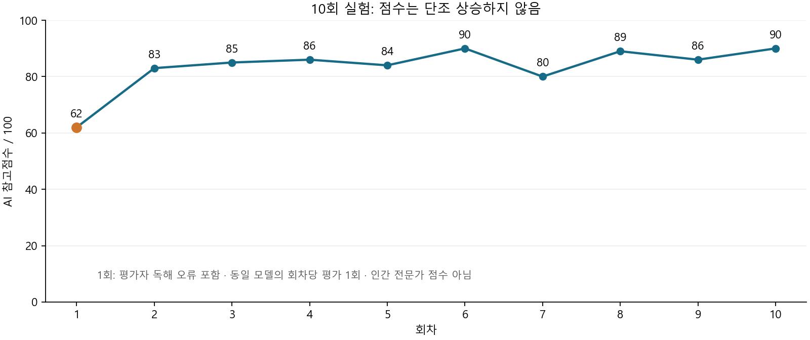

# 태스크 기억 개선 후 10회 실험 비교 보고서

작성일: 2026-11-08 · 대상: 2025년 9월 우리 집 체감물가와 생활비 대응 · 작성/검토: Codex

**판정: 승인 지식의 지속 유지와 보고서의 구체화는 확인했다. 회차마다 자동으로 더 좋아지거나 전문가 수준으로 발전한다는 주장은 입증하지 못했다.**

10개 보고서의 계산·구조 검사가 통과했고 초기 교훈은 10회까지 유지됐다. 통계 요약 위주의 첫 보고서에 조건별 행동, 가정, 산식과 비교 기준이 추가됐다. 반면 피드백을 저장해도 본문에서 빠지는 경우가 있었고, 평가자 오독·Codex 교훈 오류·최종 내부 표식 노출도 관찰됐다.

## 실험 조건

- 같은 2025-09-01~09-30, 같은 A/B 가상 가구 입력, 같은 작성 계약·루브릭·gpt-6-luna를 사용했다. 실제 사용자 생활비 자료가 아니다.
- 새 전용 DB와 새 Task에서 작성10회·분리된 AI 평가10회를 수행했다. 각 회차를 Codex가 읽고 근거를 확인한 피드백만 다음 회차에 적용했다. 이는 인간 전문가 검토가 아니다.
- 사용자가 이번 실험에 한정하여 적용을 명시적으로 승인했다. 초기 계산7개·필수항목3개를 적용하고, 1회 뒤 새 Task에서 수집한 원문 인용1개를 추가했다. 과거42개 보고서·평가 의견은 주입하지 않았다. 초기 방법은 앞선 실험의 교훈을 사용하므로 무경험 기준선은 아니다.
- 8회부터 새 체크리스트1개, 10회에 새 계산1개를 적용했다. 검색 결과와 적용 지식이 바뀌므로 순수 기억 효과나 동일 방법의 성능 비교는 아니다. 사전 계획과 개입 시점은 [PROTOCOL.md](PROTOCOL.md)에 남겼다.
- 유효 보고서10개를 얻기까지 작성 Run은12개였다. 최초 JSON 검증 실패1건과 ValueError로 끝난 실행 실패1건을 보존했다. 후자는 상세 응답/오류 메시지가 저장되지 않아 구체적 원인을 확정할 수 없다. 실패한 초안을 성공 회차로 집계하지 않았다.

## 회차별 달라진 점

|회차|AI 참고점수|고정된 활성 지식|원문 문자 수(링크·표 포함)|전 회차 대비 관찰|
|---|---:|---:|---:|---|
|[1회 원문](round-01/report.md)|62*|10|2,117|기준 보고서. 정확한 계산표는 있으나 제목 중복·막연한 행동 안내.|
|[2회 원문](round-02/report.md)|83|12|2,269|서론에 점검 우선순위, 8월 감면 근거 추가. 중복 제목은 남음.|
|[3회 원문](round-03/report.md)|85|13|2,144|중복 제목 제거, 가구 기준지출 복원, 선택형 지출 목표 산식 추가.|
|[4회 원문](round-04/report.md)|86|14|2,337|식품 비중이 가구별 차이를 만드는 이유를 본문에서 설명.|
|[5회 원문](round-05/report.md)|84|15|2,538|8월→9월 원인 흐름, 이자 가정, 같은 기간의 지출 비교 보강.|
|[6회 원문](round-06/report.md)|90|16|2,495|할인 종료·사용량·단가·수량을 구분하는 조건별 행동 추가.|
|[7회 원문](round-07/report.md)|80|17|2,514|이자 산식 추가. 생활비 산식은 미반영. 평가점수는 크게 하락.|
|[8회 원문](round-08/report.md)|89|18|2,672|산식 피드백을 필수항목으로 전환해 생활비 산식·차이 의미 반영.|
|[9회 원문](round-09/report.md)|86|19|2,927|통신비 설명의 직접 원문 연결 복원. 링크와 분량 과다.|
|[10회 원문](round-10/report.md)|90|20|2,264|CPI 기준액 42,000원 추가, 링크·분량 정리. 내부 표식 노출은 남음.|

*1회 62점에는 평가자가 올바른 하락 문장을 상승으로 오독한 감점이 포함된다. 점수는 수정하지 않았다. 2회와 비슷한 표현인데 사실 평가가 2/5→5/5로 달라졌으므로 21점 상승 전부를 개선으로 해석하면 안 된다.

평균은83.5점이며, 6회와10회가90점으로 같다. 2~5회 평균84.5점, 6~10회 평균87.0점이라는 차이는 있지만 한 번씩의 같은 모델 평가·적응 개입·변동 검색이 섞여 통계적 향상이나 인과효과로 볼 수 없다. 6→7회 90→80점도 확인된 산술 오류 없이 발생했다. 원점수와 [차원별 평가·근거](summary.json)를 함께 보아야 한다.

## 무엇이 실제로 개선됐나

**읽고 행동하기:** 3회부터 중복 제목이 사라졌다. 막연한 기록 권고에 선택지출 목표·기간·점검 조건이 붙었고, 6회에는 할인 종료와 사용량, 식품의 단가와 구매량을 분리하도록 안내했다. 링크·표를 포함한 원문은10회가9회보다 약22.7% 짧아졌다. 이는 화면에 보이는 순수 본문 길이와 다르며, 최종본도 통계 문단의 밀도와 가독성 문제가 남았다.

**검토하기:** 5회부터 대출 스트레스의 원금·금리와 제외항목이 명시됐고, 7회에는 이자 산식이 들어갔다. 8회부터는 생활비 산식, 가중률, CPI 비교액, 차이가 양수라는 의미가 별도 절로 정리됐다. 10회는 검산한 CPI 비교 기준액42,000원을 백엔드 표에 추가했다.

**유지하기:** 첫 교훈이10회까지 실제 작성 입력에 남았다. 활성 지식은10→20개로 늘었고 모든 보고서의 초기 계산7개는 정확한 표 값으로 유지됐다. 다만 계산표는 코드가 제공하므로 모델이 산술 능력을 학습한 증거는 아니다. 지식 개수 증가 자체도 품질 점수가 아니다.

**자료 찾기:** 2회부터8월 원문을 근거로 한 달 감면 종료를 설명할 수 있었다. 이후 가중치·개인 체감 안내와 여러 동향 페이지를 검색했지만 후반의 새 검색이 새로운 경제적 발견으로 이어진 경우는 확인하지 못했다. 자료 수보다 주장과 직접 연결되는 원문 선택이 중요했다. 핵심 원문은 [9월 공식 브리핑](https://www.korea.kr/news/policyNewsView.do?newsId=156721918)과 [8월 공식 브리핑](https://www.korea.kr/news/policyNewsView.do?newsId=156721800)이다.

## 남은 문제와 검토자의 오류

1. **지식 보존과 실행은 다르다.** 생활비 산식을 설명하라는 교훈이7회에도 누락됐다. 이를8회부터 필수항목으로 바꾸자 본문에 반영됐다. 이번에는 저장한 의견의 수보다 실행 가능한 규칙으로 바꾼 개입이 더 뚜렷한 변화를 만들었다. 단일 사례 관찰이다.
2. **AI 비평을 그대로 학습시키면 안 된다.** 1회 평가자의 부호 오독은 기각했다. 중대오류 표시는 AI가1건 제기했지만 Codex 대조에서는 해당 문장이 원문과 같은 의미여서 확인 오류로 인정하지 않았다. 그렇다고 보고서 전체를 독립 검증 완료했다고 주장하지 않는다.
3. **Codex의 검토도 틀릴 수 있다.** 6회 뒤 교훈에 제가 같은 단가라고 잘못 적었다. 고정한 것은 품목 구성·수량이며 가격은 변한다. 해당 지식을 철회·교정했고 이미 고정된7회 입력은 보존했다. 7회 본문은 이 오류를 반복하지 않았다. [노출 Run과 교정 이력](round-06/operator_correction.json)을 공개한다.
4. **정확한 계산도 편집 검사가 필요하다.** 10회 비교액은42,000원으로 맞지만 행 제목이 검토 교훈09라는 내부 이름으로 출력됐다. 일반 독자를 위한 이름으로 바꾸어야 한다. 평가자도 이를 지적했다. 원본 실험 보고서는 고쳐 쓰지 않았다.
5. **원문 URL은 검증 완료 표지가 아니다.** 읽을 수 없는 PDF·다른 페이지·후행 readback을 구분했다. 생성 당시 평가에 쓴 자료는 각 회차 review_context.json, 이후 추가 읽기는 별도 기록에 남았다.

## 회차별 검토 상세

### 1회 — 62점(참고)

**직전 피드백 반영:** 초기 승인 계산7개와 필수항목3개를 모두 반영. 아직 이전 회차 피드백 없음.

**남은 약점·퇴행:** 첫 시도 JSON 후행 문자로 검증 실패, 두 번째 미완료 ValueError, 세 번째 성공. 원래 실패 이력 보존.

**평가 의견 검토:** critical_errors의 신선식품 부호 누락 주장은 기각한다. 본문의 전년동월비 2.5%, 전월비 0.9% 하락에서 하락은 두 수치를 모두 수식한다. 공식 원문도 같은 표현이다. 점수62는 이 오독으로 낮아졌으나 원 점수를 보존한다. 해당 성공 Run의 추가 PDF는 원문 읽기 불가이며, 원문 독립 검증 완료 주장은 하지 않았다.

[보고서](round-01/report.md) · [AI 평가 원본](round-01/grade.json) · [Codex 검토·적용 기록](round-01/operator_review.json)

### 2회 — 83점(참고)

**직전 피드백 반영:** 첫 문단 행동은 반영. 반복 제목 제거, 방향 각각 명시, 선택형 절감 목표는 미반영. 초기 계산7개는 유지.

**남은 약점·퇴행:** 가구의 구체적 지출80/120·40/160만원이 본문에서 사라져 계산표를 이해하는 연결이 약해졌다. 동일 제목 ##/### 반복과 자동으로 덧붙는 표 표현 지속.

**평가 의견 검토:** 신선식품 문장 구조가 1회와 같은데 facts가2→5로 변했고 critical은1→0이다. 점수21점 상승 전체를 실제 개선으로 해석하면 안 된다. 이번 중대오류 없음 판정은 원문과 부합한다.

[보고서](round-02/report.md) · [AI 평가 원본](round-02/grade.json) · [Codex 검토·적용 기록](round-02/operator_review.json)

### 3회 — 85점(참고)

**직전 피드백 반영:** 2회 뒤의 편집·가구 입력·선택 목표 교훈을 대부분 반영했다. 신선식품 문장에는 각각 하락을 넣었으나 방향을 수치마다 반복하지는 않음.

**남은 약점·퇴행:** 달 지출을 X로 잡아 다음4주와 비교하면 기간 길이가 다를 수 있다. 새 방법론 PDF는 읽기 불가여서 핵심 개선 근거로 인정하지 않는다.

**평가 의견 검토:** 중대오류 없음. 설명3/5는 8월→9월 요금 흐름 연결이 약하다는 관찰과 부합한다. 일시적 기저라는 용어 대신 같은해 한시 할인·종료를 직접 설명하는 것이 안전하다.

[보고서](round-03/report.md) · [AI 평가 원본](round-03/grade.json) · [Codex 검토·적용 기록](round-03/operator_review.json)

### 4회 — 86점(참고)

**직전 피드백 반영:** 가구 차이의 원인 연결은 반영. 8월 한 달 감면→9월 종료의 시간순 설명은 여전히 축약돼 있음. 계산·선택 목표·중복 제목 제거는 유지.

**남은 약점·퇴행:** 선택지출 X의 기간이 불명확하고 이자표에는 원금·금리·제외범위가 없어 독자가 재현하기 어렵다.

**평가 의견 검토:** 중대오류 없음은 수치·원문과 일치. 원금과 금리 조건을 함께 적자는 의견 채택. 방법론 URL의 호스트 차이는 공식 도메인 이동 가능성도 있어 출처 조작으로 취급하지 않는다.

[보고서](round-04/report.md) · [AI 평가 원본](round-04/grade.json) · [Codex 검토·적용 기록](round-04/operator_review.json)

### 5회 — 84점(참고)

**직전 피드백 반영:** 3회 뒤 시간흐름 교훈은 한 회차 늦게 반영. 4회 뒤의 동일기간·이자 조건은 반영. 가구 차이도 서론으로 올라왔다.

**남은 약점·퇴행:** 자료가 늘며 본문이 길어졌다. 목표예시를 절감 목표가 아니라고 부르는 표현은 부정확하다. 산술표는 정확하나 CPI 대비 차이의 기준금액·산식은 아직 드러나지 않는다.

**평가 의견 검토:** 중대오류 없음. 이자 조건과 시간흐름이 개선됐는데 총점86→84, households5→4로 내려갔다. 단일 평가 변동과 실제 개선을 구분해야 한다. 산식 보강 제안은 타당하나 새 계산지식을 추가할 활성 예산이 제한되므로 계산표의 값은 유지하고 설명에서 산식만 안내한다.

[보고서](round-05/report.md) · [AI 평가 원본](round-05/grade.json) · [Codex 검토·적용 기록](round-05/operator_review.json)

### 6회 — 90점(참고)

**직전 피드백 반영:** 5회 뒤 조건별 행동 교훈이 반영됐다. 4회 뒤 이자 가정은 유지됐으나 월 차이 산식은 여전히 생략.

**남은 약점·퇴행:** 내용을 축적하며 같은 청구서 지침이 앞뒤에 반복된다. CPI 차이 표의 양수 의미·기준 산식은 여전히 암묵적이다.

**평가 의견 검토:** 중대오류 없음. 총점90으로 올랐지만 근거가 기존의 정확한 계산표와 명확해진 행동인 점을 구분한다. 추가 원인 예시는 공식 근거 범위에서만 허용한다.

[보고서](round-06/report.md) · [AI 평가 원본](round-06/grade.json) · [Codex 검토·적용 기록](round-06/operator_review.json)

### 7회 — 80점(참고)

**직전 피드백 반영:** 이자 산식과 고정 바구니 한계를 반영했으나 생활비 연산·CPI 차이의 양수 의미는 여전히 없음. 사후 철회된 교훈의 같은 단가 오류는 본문에 전파되지 않았고, 품목 구성·수량 고정으로 올바르게 서술했다.

**남은 약점·퇴행:** 8월50% 감면 수치가 빠짐. 핵심 내용은 대부분 유지됐는데 AI 점수가90→80으로 크게 하락.

**평가 의견 검토:** 모든 항목을 일괄4점으로 준 평가이며, 사실·산술의 실제 오류는 제시하지 못했다. 원점수는 보존하되 10점 하락을 실질 퇴행으로 해석하지 않는다. Codex 교훈 오류·철회·교정은 round-06/operator_correction.json으로 별도 보존한다.

[보고서](round-07/report.md) · [AI 평가 원본](round-07/grade.json) · [Codex 검토·적용 기록](round-07/operator_review.json)

### 8회 — 89점(참고)

**직전 피드백 반영:** 누락되던 산식 피드백이 CHECKLIST 전환 직후 반영됐다. 단순 교훈 누적만의 효과가 아니라 출력 구조 개입 효과가 포함된다. 교정한 단가 표현은 올바르게 유지됐다.

**남은 약점·퇴행:** 검토 가능성은 높아졌으나 본문이 길어졌다. 직접 통신비 설명이 있는 브리핑 대신 요약 동향 페이지를 인용해 출처 연결이 약해졌다.

**평가 의견 검토:** 중대오류 없음. 산식·가구·한계 개선은 실제 본문과 부합한다. 출처3/5는 수치 출처가 공식이라도 통신비 인과 설명까지 직접 확인하기 어렵다는 문제로 해석하며 출처 조작이라고 단정하지 않는다.

[보고서](round-08/report.md) · [AI 평가 원본](round-08/grade.json) · [Codex 검토·적용 기록](round-08/operator_review.json)

### 9회 — 86점(참고)

**직전 피드백 반영:** 직접 원문 연결은 반영됐으나 기존 동향 페이지도 그대로 남아 링크와 긴 통계 문단이 유지됐다.

**남은 약점·퇴행:** 같은 내용을 더 많은 링크로 설명해 간결성 문제는 해결되지 않았다. CPI 차이의 기준금액은 식으로만 드러나 독자가 별도 계산해야 함.

**평가 의견 검토:** 중대오류 없음. facts5→4는 반대되는 원문·오류 구절이 제시되지 않아 의미적 사실 퇴행으로 판정하지 않는다. CPI 기준액42000원 제안은 고정입력의 A·B 총지출200만원×2.1%를 Decimal로 확인했다.

[보고서](round-09/report.md) · [AI 평가 원본](round-09/grade.json) · [Codex 검토·적용 기록](round-09/operator_review.json)

### 10회 — 90점(참고)

**직전 피드백 반영:** 9회 뒤의 검산한 비교액 피드백이 실제 표에 들어왔다. 기존 첫 회차 교훈과 초기 계산도 유지. 10회에서 중단하며 이번 비평을 적용한11회는 만들지 않는다.

**남은 약점·퇴행:** 새 계산 행 제목이 검토 교훈09라는 내부 표식으로 노출됐다. 숫자는 정확하지만 독자용 이름으로 바꾸어야 한다. 통계는 여전히 긴 한 문단이며 간결성 문제는 남았다.

**평가 의견 검토:** 중대오류 없음과 내부 표식 지적은 실제 원문과 부합한다. 원점수90을 보존하되 가독성3/5와 라벨 결함이 남아 최종 완성본이나 전문가 동등 품질로 판정하지 않는다.

[보고서](round-10/report.md) · [AI 평가 원본](round-10/grade.json) · [Codex 검토·적용 기록](round-10/operator_review.json)

## 완료와 검증 범위

정확히10개 Work, 작성 Run12개, 성공10개·실패2개, 큐10개 모두 DONE이다. 보고서 Work는 모두 WAITING_APPROVAL이며 공식 채택이나 기존 운영 방법 승격을 하지 않았다. 새 Task는 USER-545faf8c-091f-462f-a834-86c909606fd7이고 연구 상태는 STOPPED_AFTER_COMPLETING_AUTHORIZED_TEN_ROUNDS로 잠갔다. 11회차는 없다.

실제 DB·파일 대조에서10개 Artifact 해시, 같은 입력·작성 계약, 초기 계산값 유지, 오래된 교훈 유지, 미승인 AI 의견의 실제 작성 프롬프트 제외를 확인했다. 기존42개 Artifact의 해시도 모두 일치했고 원래 Task에 적용한 지식은0개다. [최종 검사](final_checks.json) · [모든 시도](attempts.json) · [원 입력](source.json) · [루브릭](rubric.json).

이번 추가 실행 도구는 py_compile과 중단 연구 실행 차단 회귀1개(1 passed, 6 deselected)로 확인했다. 앞선 전체115개 테스트를 이번 요청에서 재실행한 것으로 표시하지 않는다.

**사용자 의도와의 일치:** 같은 태스크의 기억을 유지하고 검토를 다음 결과에 반영하는 경로는 작동했다. 그러나 Codex의 회차별 개입, 구조 규칙 강화, 코드 계산이 포함돼 무개입 자율 발전의 입증은 아니다. 여러 태스크 간 격리, 다른 가구로의 일반화, 인간 전문가 대비 품질은 이번10회로 평가하지 않았다.

**다음 개선 우선순위:** 독자용 계산 이름 검사 → 교훈을 실행 항목으로 전환하는 기준 → 검토자 오류를 잡는 원문 대조 사례 → 다른 가구와 무기억 대조·사람 평가 순서가 적절하다. 이번10회 실험은 여기서 끝낸다.
